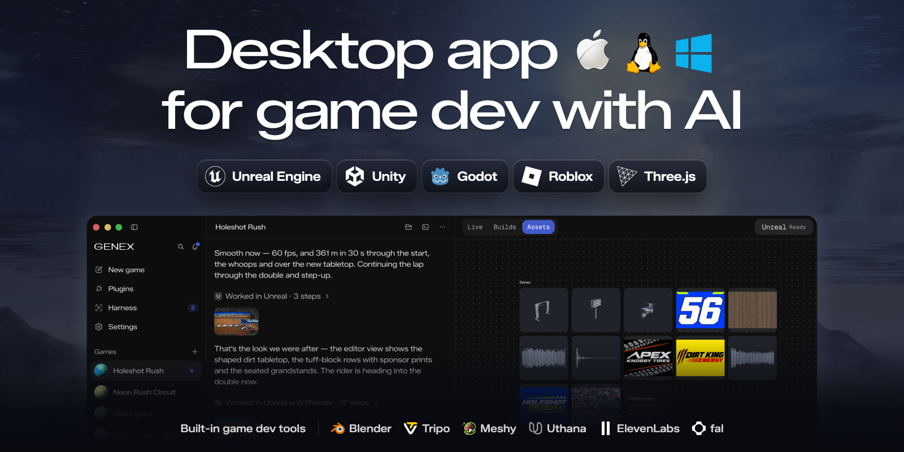

<p align="center">
  <a href="https://genex.games">
    <picture>
      <source srcset=".github/logo-dark.svg" media="(prefers-color-scheme: dark)">
      <source srcset=".github/logo-light.svg" media="(prefers-color-scheme: light)">
      
    </picture>
  </a>
</p>
<p align="center"><a href="README.md">English</a> · <a href="README.ru.md">Русский</a> · <a href="README.es.md">Español</a> · <a href="README.pt-BR.md">Português</a> · <a href="README.de.md">Deutsch</a> · <a href="README.fr.md">Français</a> · <b>日本語</b> · <a href="README.ko.md">한국어</a> · <a href="README.zh-Hans.md">简体中文</a></p>
<p align="center">AIでゲームをつくる、オープンソースのデスクトップアプリ。<br>エージェントがエンジンを準備し、ゲームをつくり、自分でテストプレイまで行います。</p>
<p align="center">
  <a href="https://github.com/genex-games/genex-desktop/releases/latest"></a>
  <a href="LICENSE"></a>
  <a href="https://github.com/genex-games/genex-desktop/actions/workflows/check.yml"></a>
</p>

<p align="center"></p>

---

### ダウンロード

| プラットフォーム | ダウンロード |
| --- | --- |
| macOS (Apple Silicon) | [`Genex.dmg`](https://github.com/genex-games/genex-desktop/releases/latest/download/Genex.dmg) |
| Linux (x64) | [最新リリース](https://github.com/genex-games/genex-desktop/releases/latest)から`.deb`、`.rpm`、`.zip`のいずれかを入手してください。`.deb`と`.rpm`はGenexのパッケージリポジトリを追加するので、システムのアップデート（Software Updater、`apt`、`dnf`）で以降のバージョンも届きます |
| Windows (x64)、プレビュー版 | [`Genex-Setup.exe`](https://github.com/genex-games/genex-desktop/releases/latest/download/Genex-Setup.exe)。まだ署名されていません。Windowsの警告が出たら「詳細情報」を押し、「実行」を選んでください |

Genexはまだ初期段階です。粗い部分があれば、
[issues](https://github.com/genex-games/genex-desktop/issues)で教えてください。

### できること

→ Unreal Engine、Unity、Godot、Roblox Studio、Three.jsでゲームをつくれます\
→ 好きなAIで：Claude Code、Codex (ChatGPT)、Antigravity、Cursor、Grok、OpenCode、OpenRouter\
→ ローカルモデルも：Ollama、LM Studio、llama.cpp\
→ マルチエージェント：メインエージェント、ワーカー、レビュアーにそれぞれ別のモデルを使えます\
→ ゲーム制作ツールを内蔵：Blender、Tripo、Meshy、Uthana、ElevenLabs、fal\
→ サーバー権威型のマルチプレイを、プロンプトひとつで\
→ Web、Mac、Windows、Linuxに公開

> [!TIP]
> ゲームに欲しいツールがありますか？[プラグインをつくって](#build-a-plugin)、Genexのマーケットプレイスで
> みんなに公開しましょう。

### 開発に参加する

Apple SiliconのmacOS、Git、Node 24が必要です。

```bash
git clone https://github.com/genex-games/genex-desktop.git
cd genex-desktop
nvm install && nvm use   # .nvmrcのNode 24
npm ci
npm run studio:dev -- start --profile first-run --fixture app-basics
```

フィクスチャはスクリプトで動くモデルとサンプルゲームでアプリを起動するので、アカウントは不要です。
プルリクエストを出す前に[CONTRIBUTING.md](CONTRIBUTING.md)を読んでください。コーディングエージェントは
[AGENTS.md](AGENTS.md)から始めます。

<a id="build-a-plugin"></a>

### プラグインをつくる

プラグインはGenexのエージェントに新しいツールを与えます。アセットの生成、エンジンとの連携、
ゲームが通信するサービスなどです。アプリに付属しているBlenderやGenexのツールもプラグインです。
Genexのリポジトリをチェックアウトしたフォルダーで：

```bash
npm run plugin:new -- my-plugin --out ~/studio-plugins   # サンプルからつくる
npm run plugin:doctor -- ~/studio-plugins/my-plugin      # Genexと同じ方法でチェックする
```

1. **試す**：アプリで **プラグイン → 追加 → ローカルプラグインを読み込む…** を開き、フォルダーを選びます。
2. **共有する**：公開のGitHubリポジトリにプッシュし、バージョンごとにリリースを公開します。
   誰でも **プラグイン → 追加 → GitHubからインストール…** でインストールできるようになります。
3. **カタログに載せる**：
   [genex-plugins](https://github.com/genex-games/genex-plugins/blob/main/CONTRIBUTING.md)に
   プルリクエストを出します。メンテナーが確認すると、すべてのGenexアプリのマーケットプレイスに表示されます。

ツール、パネル、設定、アカウントについては[プラグインガイド](docs/PLUGIN_GUIDE.md)を見てください。

### ドキュメント

ドキュメントは今のところ英語のみです。

- [製品の概要](docs/agent/context.md)：アプリでできること。機能ごとにページがあります
- [開発者ガイド](docs/STUDIO-DEVELOPER-FIELD-GUIDE.md)：実行コマンドとデータの保存場所
- [リリース作業](docs/release-operations.md)：パッケージ化、署名、リリースの公開

<a id="code-signing-policy"></a>

### コード署名ポリシー

無料のコード署名は[SignPath.io](https://about.signpath.io/)、証明書は
[SignPath Foundation](https://signpath.org/)により提供されています。

Windowsビルドに署名するのは、このリポジトリのソースからGitHub Actionsがビルドした場合だけです。
各リリースは署名の前にメンテナーが承認します。
署名の準備が整うまで、Windowsビルドは署名なしのプレビュー版として公開します。各リリースには
`SHA256SUMS`に全ファイルのSHA-256を載せています。

- コミッターとレビュアー：[genex-gamesのメンバー](https://github.com/orgs/genex-games/people)
- 承認者：[genex-gamesのオーナー](https://github.com/orgs/genex-games/people?query=role%3Aowner)

プライバシー：Genexが保存・送信する内容は[プライバシーポリシー](PRIVACY.md)にあります。
接続したプロバイダー、プラグイン、サービスにはそれぞれのポリシーがあります。

---

[プライバシー](PRIVACY.md) · [セキュリティ](SECURITY.md) · [コード署名ポリシー](#code-signing-policy) ·
[MITライセンス](LICENSE)、copyright `genex.games` · [サードパーティーの表記](THIRD-PARTY-NOTICES.md)
